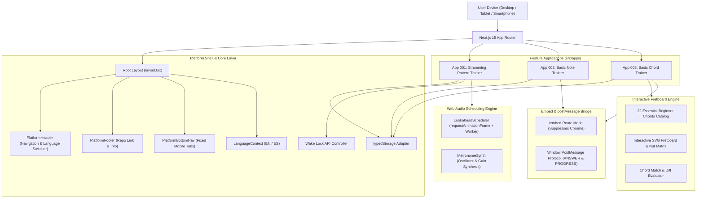

# Architecture Documentation - Guitar Companion

This document provides a comprehensive overview of the architecture, design principles, module organization, and technical contracts powering **Guitar Companion**.

---

## 1. System Overview & Core Philosophy

**Guitar Companion** is built as a modular, client-first Next.js application designed to provide instantaneous, distraction-free practice tools for guitarists. It follows five foundational design principles:

1. **Zero-Mock UI & Local Persistence**:
   Users can begin practicing immediately without account registration, paywalls, or third-party telemetry. All user preferences, created strumming patterns, and session statistics are persisted client-side via typed `localStorage` adapters with automatic schema validation and fallback defaults.
2. **Deterministic, Hardware-Accelerated Audio**:
   Standard browser `setInterval` or `setTimeout` timers suffer from severe timing jitter when the main JavaScript thread is busy. Guitar Companion uses a **Web Audio API lookahead scheduler** to schedule synthesized audio pulses directly onto the hardware audio clock, ensuring microsecond-accurate tempo and subdivision precision.
3. **Dual Notation & Bilingual Core**:
   The entire system natively supports both the **Anglo-Saxon pitch system** (`A`, `B`, `C`, `D`, `E`, `F`, `G`) and the **European Solfège system** (`Do`, `Re`, `Mi`, `Fa`, `Sol`, `La`, `Si`). Both systems are presented simultaneously in pedagogical drills so students develop dual-system fluency. The UI provides instantaneous toggle between English and Spanish.
4. **Embed & Widget Portability**:
   Every practice tool features a lightweight headless `/embed` route that suppresses platform headers, mobile footers, and outer platform chrome. It communicates session results with host web pages (such as LMS portals or music blogs) using a strictly typed `window.postMessage` bridge.
5. **Responsive, Touch-First Interface**:
   All clickable and interactive elements strictly meet the 44x44px minimum touch target size standard, accompanied by fixed bottom tab navigation for smartphones and native Screen Wake Lock integration to keep devices illuminated during two-handed guitar practice.

---

## 2. High-Level Architecture Diagram



---

## 3. Technology Stack

| Layer | Technology | Version | Purpose |
| :--- | :--- | :--- | :--- |
| **Framework** | Next.js (App Router) | 15.1.0 | Server-side rendering, routing, and standalone production server |
| **UI Library** | React | 19.0.0 | Component declarative rendering and reactive hooks |
| **Language** | TypeScript | 5.7+ | Strict static typing, type safety across storage and bridges |
| **Styling** | Tailwind CSS | v4.0.0 | Utility-first styling with dark slate/amber palette |
| **Icons** | Lucide React | 1.16+ | Clean, accessible vector icons for UI navigation and controls |
| **Runtime & Tests** | Bun | 1.4+ | Rapid dependency installation, script execution, and test runner |
| **Unit Testing** | Vitest + jsdom | 3.0+ | DOM simulation, Web Audio mocks, and headless test suite |
| **Deployment** | Docker & Compose | Multi-stage | Alpine/Debian standalone container running on port 3100 |

---

## 4. Directory Structure

```
guitar-companion/
├── src/
│   ├── app/                               # Next.js 15 App Router Routes
│   │   ├── (apps)/                        # Grouped Application Routes
│   │   │   ├── strumming/                 # Route: /strumming
│   │   │   ├── basic-note-trainer/        # Route: /basic-note-trainer
│   │   │   │   └── embed/                 # Headless Embed Route
│   │   │   └── basic-chord-trainer/       # Route: /basic-chord-trainer
│   │   │       └── embed/                 # Headless Embed Route
│   │   ├── api/health/                    # Docker & uptime health check endpoint
│   │   ├── globals.css                    # Tailwind CSS v4 directives & root theme
│   │   ├── layout.tsx                     # Top-level shell with dual-mode detection
│   │   └── page.tsx                       # Platform homepage / hub
│   ├── core/                              # Platform-wide reusable infrastructure
│   │   ├── audio/                         # Wake Lock API & audio utilities
│   │   ├── i18n/                          # Translations (EN/ES) and LanguageContext
│   │   ├── storage/                       # Type-safe LocalStorage adapter
│   │   ├── types/                         # Common shared interfaces
│   │   └── ui/                            # Shared components (Header, Footer, Nav, Buttons)
│   └── apps/                              # Self-contained business modules
│       ├── strumming/                     # Audio synthesis, grid state, lookahead
│       ├── basic-note-trainer/            # Music theory engine, flashcards, session logic
│       └── basic-chord-trainer/           # Chord catalog, SVG fretboard, draw/identify engines
├── tests/                                 # Unit & integration test suites
│   ├── setup.ts                           # jsdom & Web Audio API mock configuration
│   ├── unit/                              # Tests for core utilities & strumming
│   └── apps/                              # Tests for note and chord trainer domains
├── docs/                                  # Documentation assets & screenshots
│   └── screenshots/                       # Preview mockups and interface captures
├── public/                                # Static Next.js web assets
├── Dockerfile                             # Multi-stage optimized production image
├── docker-compose.yml                     # Local & production compose stack
└── package.json                           # Scripts and dependencies
```

---

## 5. Core Platform Layer (`src/core`)

### 5.1 Internationalization (`src/core/i18n`)
- Implemented as a lightweight React Context (`LanguageContext`) avoiding heavy external dependencies.
- Exposes `{ language, setLanguage, t }` where `t` is fully type-checked against `TranslationDictionary`.
- Persists user language preference in `localStorage` with fallback to `en`.
- Supports dynamic switching on the fly without page reloads.

### 5.2 Local Storage Adapter (`src/core/storage/typedStorage.ts`)
- Provides generic read/write methods: `get<T>(key: string, fallback: T): T` and `set<T>(key: string, value: T): boolean`.
- Wraps JSON serialization in `try/catch` blocks to protect against private browsing quota exceptions or malformed stored data.
- Ensures zero runtime crashes when browser storage is restricted.

### 5.3 Screen Wake Lock (`src/core/audio/wakeLock.ts`)
- Interfaces with the browser `navigator.wakeLock` API.
- Automatically requests a screen lock when a practice session starts and releases it upon session completion or pause.
- Gracefully degrades on unsupported browsers without throwing exceptions.

### 5.4 Dual-Layout & Chrome Shell (`src/core/ui`)
- `PlatformHeader`: Desktop navigation bar containing platform branding, application links, and the language switcher. Automatically collapses on mobile screens.
- `PlatformBottomNav`: Fixed bottom tab bar for smartphone viewports with touch-friendly 44px hit targets and short labels to avoid overflow.
- `PlatformFooter`: Platform footer containing descriptive metadata and a direct link to the GitHub repository (`https://github.com/JorgeRuizDev/guitar-companion`).
- **Route Suppression**: When navigating to any route containing `/embed`, `PlatformHeader`, `PlatformBottomNav`, and `PlatformFooter` automatically return `null`, rendering only the focused practice widget.

---

## 6. Applications Deep Dive (`src/apps`)

### 6.1 App 001: Strumming Pattern Trainer

The rhythm trainer requires absolute temporal accuracy. It relies on a two-tier timing architecture:

```
+-------------------------------------------------------------+
|                     Main JS Thread                          |
|  LookaheadScheduler (Tick interval: 25ms, Lookahead: 100ms) |
+------------------------------+------------------------------+
                               | Schedules Web Audio Nodes
                               v
+-------------------------------------------------------------+
|                  Web Audio API Context Clock                |
|  - Precision AudioParam.setValueAtTime()                    |
|  - MetronomeSynth (OscillatorNode + GainNode Exponential)   |
|  - Accented Beat 1 (1000Hz, Gain 0.9)                       |
|  - Regular Pulses (800Hz, Gain 0.6)                         |
|  - Subdivision Ticks (1200Hz, Gain 0.25)                    |
|  - Session Chime (Dual harmonic chord 523Hz + 659Hz)        |
+-------------------------------------------------------------+
```

- **Lookahead Scheduling**: A low-frequency ticker (every 25ms) schedules notes ahead of time into the `AudioContext.currentTime` timeline with a 100ms lookahead buffer.
- **Stroke Alternation Engine**: Enforces positional down-up motion (e.g. 1 2 3 4 down, '&' and subdivisions up) while permitting free-form override mode.
- **State Storage**: Default patterns (*Island Strum*, *Pop Ballad*, etc.) loaded instantly, with custom patterns saved to localStorage.

### 6.2 App 002: Basic Note Trainer

- **Theory Engine**: Fully bijective translation table between Anglo-Saxon pitch letters (`A`, `B`, `C`, `D`, `E`, `F`, `G`) and European Solfège notes (`La`, `Si`, `Do`, `Re`, `Mi`, `Fa`, `Sol`).
- **Natural Semitones**: Explicit rule validation confirming that `B-C` and `E-F` are natural half-steps without sharp/flat intermediaries.
- **Challenge Dispatcher**: Generates randomized flashcard challenges with target answer verification, accuracy scoring, and consecutive hit streaks.

### 6.3 App 003: Basic Chord Trainer

- **Chord Catalog**: Standardized database of the 22 fundamental open guitar chords across 6 chord qualities (Major, Minor, 7, m7, maj7, sus4).
- **Interactive SVG Diapasón**:
  - 6 strings (Low E to High E) with individual nut indicators (`open`, `muted`).
  - 4 playable frets with active dot coordinates.
  - Color-coded feedback: Neutral slate during input, emerald green on correct placement, red diff on misplacement.
- **Practice Modes**:
  - **Draw Mode**: The user places dots on the fretboard and selects muted strings.
  - **Identify Mode**: A target diagram is presented with 4 multiple-choice options formatted in dual notation (e.g. `C (Do Mayor)`).
  - **Alternating Mode**: Dynamically switches back and forth between Draw and Identify challenges.

---

## 7. Headless Embed & `postMessage` Protocol

For seamless embedding in learning platforms (e.g., Moodle, Canvas, or interactive textbooks), `/embed` routes provide real-time event telemetry via `window.parent.postMessage`.

### 7.1 Message Contract Specification

#### Event 1: User Answer (`*_ANSWER`)
Dispatched whenever the user submits or validates an exercise:

```typescript
// Note Trainer:
window.parent.postMessage({
  type: 'NOTE_TRAINER_ANSWER',
  payload: {
    challengeId: string;
    target: string;
    userAnswer: string;
    isCorrect: boolean;
    streak: number;
    timestamp: number;
  }
}, '*');

// Chord Trainer:
window.parent.postMessage({
  type: 'CHORD_TRAINER_ANSWER',
  payload: {
    challengeId: string;
    chordSymbol: string;
    mode: 'draw' | 'identify';
    isCorrect: boolean;
    streak: number;
    timestamp: number;
  }
}, '*');
```

#### Event 2: Session Progress (`*_PROGRESS`)
Dispatched whenever aggregate session metrics change:

```typescript
window.parent.postMessage({
  type: 'CHORD_TRAINER_PROGRESS', // or 'NOTE_TRAINER_PROGRESS'
  payload: {
    totalAnswers: number;
    correctAnswers: number;
    accuracy: number;        // integer percentage 0-100
    currentStreak: number;
    bestStreak: number;
    timestamp: number;
  }
}, '*');
```

---

## 8. Production Deployment & Docker Pipeline

The production pipeline is containerized using a multi-stage Docker setup optimized for performance and small footprint.

### Multi-Stage Pipeline:
1. **Base**: `node:20-alpine` providing Node.js runtime and native dependencies.
2. **Dependencies (`deps`)**: Installs production & development npm dependencies using Bun/npm cache.
3. **Builder (`builder`)**: Builds the Next.js standalone artifact (`next build`) with static optimization.
4. **Runner (`runner`)**: Minimal production image containing only `.next/standalone`, `.next/static`, and `public`. Executes under an unprivileged `nextjs` system user (`UID 1001`).

### Health Monitoring:
- Dedicated API endpoint at `/api/health` returning JSON:
  ```json
  {
    "status": "healthy",
    "service": "guitar-companion",
    "env": "production",
    "uptime": 1836.3,
    "timestamp": "2026-11-01T17:27:51.222Z"
  }
  ```
- Integrated with Portainer and Docker container health checks.

---

## 9. Testing Strategy

The test suite is powered by **Vitest** running in the **Bun** environment with preloaded `jsdom` and Web Audio API mocks (`tests/setup.ts`).

- **Unit Tests**:
  - Theory logic (bijective conversions, accidentals, semitones).
  - Web Audio scheduler (Lookahead timing bounds, metronome pulse scheduling).
  - Storage adapter (schema isolation, fallback resilience, corruption handling).
  - Fretboard evaluator (dot positions, nut mutes, diff calculation).
  - Query parameter parser (embed mode, language overrides, preset filtering).
- **Integration Tests**:
  - `postMessage` bridge event emission.
  - Multi-lingual navigation & embed layout suppression rules.
