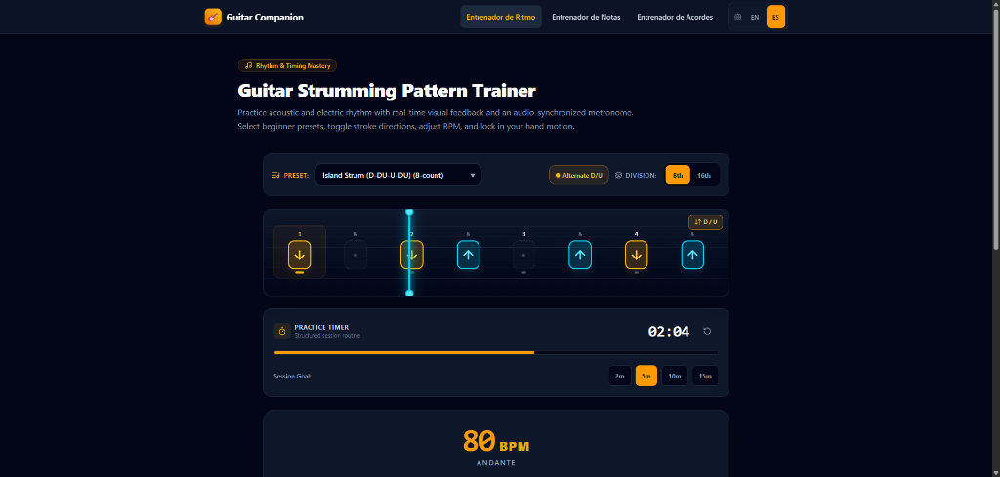

# 🎸 Guitar Companion

> An interactive, modular web suite of modern practice tools for guitarists. Practice rhythm, strumming patterns, fretboard notes, and chords with zero friction.

[](https://github.com/JorgeRuizDev/guitar-companion)
[](https://nextjs.org/)
[](https://react.dev/)
[](https://tailwindcss.com/)
[](https://bun.sh/)
[](https://www.docker.com/)

---

## 📸 Preview



---

## ✨ Overview

**Guitar Companion** is a client-side, hardware-accelerated guitar learning suite built for both acoustic and electric guitarists. It focuses on privacy, zero-latency feedback, and seamless usability across desktop and mobile devices.

### Key Highlights
- **Zero-Mock UI Guest Mode**: All user progress, patterns, and session metrics persist locally via typed LocalStorage—no mandatory login, tracking, or cloud backend required.
- **Bilingual & Dual Notation**: Full English and Spanish localization with simultaneous support for **Anglo-Saxon pitch notation** (`A`, `B`, `C`, etc.) and **European Solfège** (`Do`, `Re`, `Mi`, etc.).
- **Hardware-Accelerated Audio**: Ultra-low latency scheduling powered by the Web Audio API lookahead clock, eliminating timer drift and interval jitter.
- **Headless Embed Readiness**: Every tool provides a dedicated minimal `/embed` route and cross-window `postMessage` protocol for embedding into LMS platforms, music blogs, or classroom portals.
- **Mobile Optimized**: Responsive touch targets (minimum 44x44px), mobile bottom bar navigation, and Screen Wake Lock integration to keep screens awake during hands-on practice.

---

## 🛠 Included Practice Tools

### 1. 🎵 Strumming Pattern Trainer (`/strumming`)
A visual rhythm workbench designed to build rock-solid timing and hand-sync:
- **Visual Beat Timeline**: Interactive grid supporting quarter, 8th, and 16th note subdivisions.
- **Audio Metronome Engine**: Synthesized click pulses with accented downbeats, subtle subdivision ticks, and completion chimes.
- **Alternating Strumming Logic**: Automatic positional Down (`↓`) and Up (`↑`) stroke validation or free-form patterns.
- **Practice Presets**: Built-in classic rhythm patterns (e.g., *Island Strum*, *Pop Ballad*, *Folk Strum*).
- **Session Timer & Screen Wake Lock**: Focus intervals with audio completion chime and screen wake lock support.

### 2. 🎼 Basic Note Trainer (`/basic-note-trainer`)
Master the fretboard notes and theoretical fundamentals:
- **Bidirectional Note Flashcards**: Rapid drill practice between Anglo-Saxon letters (`A`–`G`) and European Solfège (`Do`–`Si`).
- **Chromatic Alterations**: Sharps (`#`) and Flats (`b`) recognition drills.
- **Natural Semitone Drills**: Deep understanding of half-steps without accidentals (`B-C` and `E-F`).
- **Interactive Scoring & Analytics**: Real-time accuracy metrics and streak counters.

### 3. 🎸 Basic Chord Trainer (`/basic-chord-trainer`)
Interactive fretboard training for open chords:
- **22 Essential Open Chords**: Full catalog covering Major, Minor, Dominant 7th, Minor 7th, Major 7th, and Sus4 chords.
- **Interactive SVG Fretboard**: Realistic 6-string, 4-fret interactive diapasón with nut open (`O`) and muted (`X`) indicators.
- **Two Dynamic Practice Modes**:
  - **Draw Mode**: Place fingers on string frets and configure nut states to match the target chord.
  - **Identify Mode**: Fast 4-option multiple choice recognition challenges.
  - **Alternating Mode**: Seamlessly switches between Draw and Identify exercises.
- **Preset Filter System**: Filter practice pools by beginner difficulty (e.g., *The Big 4: G, C, D, Em*, *Campfire Basics*, *All 22 Chords*).

---

## 🏗 Architecture & Design

For an in-depth breakdown of the project architecture, directory structure, Web Audio scheduling engine, state machines, and embed bridge specifications, see [ARCHITECTURE.md](./ARCHITECTURE.md).

---

## 🚀 Getting Started

### Prerequisites
- [Bun](https://bun.sh/) (version 1.2+ recommended) or Node.js 20+
- [Docker](https://www.docker.com/) (optional, for containerized deployments)

### Local Development

1. **Clone the repository**:
   ```bash
   git clone https://github.com/JorgeRuizDev/guitar-companion.git
   cd guitar-companion
   ```

2. **Install dependencies**:
   ```bash
   bun install
   ```

3. **Start development server**:
   ```bash
   bun run dev
   ```
   Open [http://localhost:3100](http://localhost:3100) in your browser.

### Running Tests

Execute the unit test suite with Vitest and Bun:
```bash
bun run test
```

### Building for Production

Compile the production standalone Next.js bundle:
```bash
bun run build
bun run start
```

---

## 🐳 Docker Deployment

The project is preconfigured with a multi-stage `Dockerfile` and `docker-compose.yml` configured for standalone production performance:

```bash
# Build and run container in detached mode
bun run docker:reload
# Or directly with Docker Compose:
docker compose up -d --build
```

Healthcheck verification:
```bash
curl -f http://localhost:3100/api/health
```

---

## 📄 License & Repository

Maintained by [Jorge Ruiz](https://github.com/JorgeRuizDev).  
Repository: [https://github.com/JorgeRuizDev/guitar-companion](https://github.com/JorgeRuizDev/guitar-companion)
