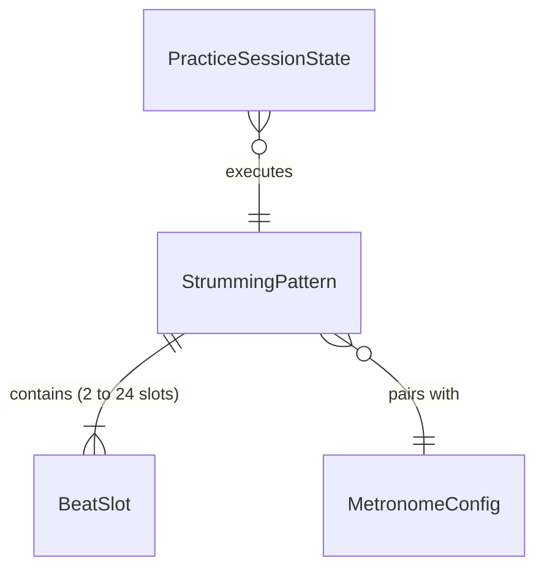
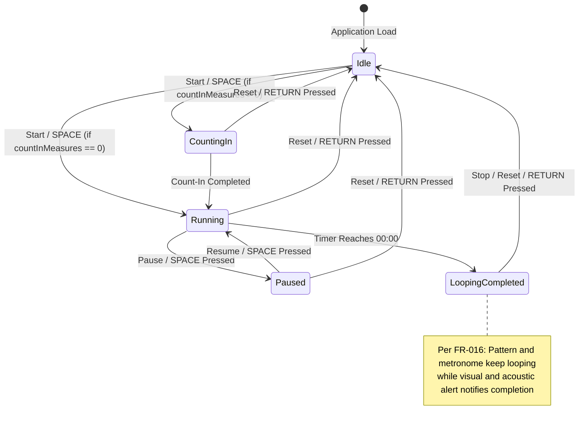

# Data Model: Strumming Pattern Trainer

**Feature**: `001-strumming-pattern-trainer`  
**Date**: 2026-11-01 (Updated 2026-11-02)  
**Status**: Completed  

---

## 1. Domain Entities & Type Definitions

### 1.1 `StrokeDirection` (Enum)
Represents the action taken on a specific rhythmic division slot.
```typescript
export type StrokeDirection = 'down' | 'up' | 'none';
```
- `'down'`: Downward strum indicated by arrow `↓`.
- `'up'`: Upward strum indicated by arrow `↑`.
- `'none'`: Empty slot / rest / silent subdivision (no stroke).

---

### 1.2 `SubdivisionUnit` (Enum) & `TimeSignature`
Defines the rhythmic division of the measure and musical meter.
```typescript
export type SubdivisionUnit = 'eighth' | 'sixteenth' | 'custom';

export type TimeSignature = [number, number]; // [beatsPerMeasure, beatValue]
```
- `'eighth'`: 8th note divisions (8 slots in 4/4; 6 slots in 3/4).
- `'sixteenth'`: 16th note divisions (16 slots in 4/4: `1`, `e`, `&`, `a`, etc.).
- `'custom'`: Variable block count between 2 and 24 slots, or compound rhythms (e.g., 6/8 compound meter).
- Supported standard and atypical meters:
  - `[4, 4]`: Common time (4 quarter beats per measure).
  - `[3, 4]`: Simple triple time (3 quarter beats per measure: waltzes, acoustic ballads).
  - `[6, 8]`: Compound duple time (6 eighth notes per measure; 2 compound dotted-quarter beats with accents on 1 and 4).
  - Custom `[N, D]`: Arbitrary user-configured meter.

---

### 1.3 `BeatSlot`
An individual slot along the rhythmic timeline.
```typescript
export interface BeatSlot {
  /** Zero-based index within the measure (0 to N-1, where N is between 2 and 24) */
  index: number;
  /** Display label corresponding to the musical count (e.g. '1', '&', 'e', 'a', '2', '3', '4', '5', '6') */
  beatLabel: string;
  /** Strum direction executed at this division */
  strokeDirection: StrokeDirection;
  /** True if this slot falls on a primary downbeat (e.g. beat 1, 2, 3, 4 in 4/4; 1, 2, 3 in 3/4; pulses 1 and 4 in 6/8) */
  isQuarterBeat: boolean;
  /** True if this slot carries secondary compound emphasis (e.g. pulse 4 in 6/8 compound meter) */
  isCompoundAccent?: boolean;
  /** True if this slot represents the very first beat of the measure */
  isMeasureStart: boolean;
}
```

**Validation Rules**:
- `index` MUST be an integer between `0` and `slotsCount - 1`.
- `strokeDirection` MUST be one of `'down'`, `'up'`, or `'none'`.
- `beatLabel` MUST NOT exceed 8 characters.

---

### 1.4 `StrummingPattern`
Represents the rhythmic pattern configuration for practice and storage.
```typescript
export interface StrummingPattern {
  /** Unique identifier (e.g., 'preset-island-strum', 'preset-waltz-ballad-3-4', or uuid for custom) */
  id: string;
  /** Human-readable title */
  name: string;
  /** Time signature represented as [beatsPerMeasure, beatValue]. Defaults to [4, 4] */
  timeSignature: TimeSignature;
  /** Subdivisions per measure ('eighth', 'sixteenth', or 'custom') */
  subdivision: SubdivisionUnit;
  /** Sequence of rhythmic slots (length dynamically configurable between 2 and 24) */
  slots: BeatSlot[];
  /** True if built into the beginner preset library; false if user-created or customized */
  isPreset: boolean;
  /** Future authentication link; always null for anonymous guest mode */
  ownerId: string | null;
  /** Timestamp when pattern was created (ISO 8601) */
  createdAt: string;
  /** Timestamp when pattern was last modified (ISO 8601) */
  updatedAt: string;
}
```

**Validation Rules**:
- `slots.length` MUST be an integer between `2` and `24` (inclusive).
- When `subdivision === 'eighth'` and `timeSignature === [4, 4]`, `slots.length` is 8.
- When `subdivision === 'sixteenth'` and `timeSignature === [4, 4]`, `slots.length` is 16.
- When `timeSignature === [3, 4]` (8th-note waltz), `slots.length` is 6.
- When `timeSignature === [6, 8]` (compound ballad), `slots.length` is 6.
- `name` MUST not be empty (minimum 1 character, maximum 50 characters).

---

### 1.5 Built-In Presets Library

The preset library provides beginner reference rhythms across standard and atypical meters:

| Preset ID | Name | Meter | Slots | Subdivision | Strum Pattern (Strokes) |
| :--- | :--- | :---: | :---: | :---: | :--- |
| `preset-island-strum` | Island Strum | 4/4 | 8 | 8th | D - D U - U D U |
| `preset-basic-8th` | Basic Beginner | 4/4 | 8 | 8th | D - D - D U - U |
| `preset-folk-ballad` | Folk Ballad | 4/4 | 8 | 8th | D - D U - U D U |
| `preset-four-on-floor` | Four on the Floor | 4/4 | 8 | 8th | D - D - D - D - |
| `preset-16th-groove` | 16th-Note Pop Groove | 4/4 | 16 | 16th | D - D U - U D U D - D U - U D U |
| `preset-waltz-basic-3-4` | Vals Básico 3/4 | 3/4 | 6 | 8th | D - D - - U |
| `preset-waltz-ballad-3-4` | Vals Balada 3/4 | 3/4 | 6 | 8th | D - D U D U |
| `preset-ballad-6-8` | Balada 6/8 | 6/8 | 6 | custom | D - D U D - D U (or D - U D - U / D D U D D U) |

---

### 1.6 Positional Alternation Mechanics & Free-Form Mode

The motor mechanic for guitar strumming relies on the physical pendulum motion of the strumming arm:

- **Positional Stroke Direction (Alternating Mode)**:
  - Odd positions (1st, 3rd, 5th, etc.; 0-indexed `index % 2 === 0`) are assigned strictly to **Downstroke** (`↓`).
  - Even positions (2nd, 4th, 6th, etc.; 0-indexed `index % 2 === 1`) are assigned strictly to **Upstroke** (`↑`).
  - Clicking an odd slot toggles between `'down'` and `'none'`.
  - Clicking an even slot toggles between `'up'` and `'none'`.
  - This rule applies universally across any block count from 2 to 24 slots.
- **Free-Form Mode**:
  - When the Alternated Mode toggle is turned OFF, clicking any slot cycles sequentially: `'none'` $\to$ `'down'` $\to$ `'up'` $\to$ `'none'`.
  - Allows arbitrary stroke configurations (e.g., all downs, DDDU, or syncopated accents) across any block count.

---

### 1.7 Timing & Duration Formulas

Timing synchronization between the Web Audio API lookahead scheduler and the GPU playhead animation relies on the following exact formulas:

$$\text{quarterBeatDuration} = \frac{60.0}{\text{BPM}}$$

$$\text{measureDuration} = \text{beatsPerMeasure} \times \left(\frac{4}{\text{beatValue}}\right) \times \text{quarterBeatDuration}$$

$$\text{slotDuration} = \frac{\text{measureDuration}}{\text{slots.length}}$$

Examples:
- In **4/4** at 80 BPM: $\text{measureDuration} = 4 \times 1 \times 0.75\text{s} = 3.0\text{s}$. (With 8 slots: $0.375\text{s}$ per slot).
- In **3/4** at 120 BPM: $\text{measureDuration} = 3 \times 1 \times 0.5\text{s} = 1.5\text{s}$. (With 6 slots: $0.25\text{s}$ per slot).
- In **6/8** at 120 BPM: $\text{measureDuration} = 6 \times \left(\frac{4}{8}\right) \times 0.5\text{s} = 3 \times 0.5\text{s} = 1.5\text{s}$. (With 6 slots: $0.25\text{s}$ per slot).

---

### 1.8 `MetronomeSubdivision` (Enum)
Defines audio click pulse subdivisions per quarter beat:
```typescript
export type MetronomeSubdivision = 'quarter' | 'eighth' | 'sixteenth' | 'triplet' | 'swing';
```
- `'quarter'`: 1 click per beat (on the quarter downbeat ♩).
- `'eighth'`: 2 clicks per beat (downbeat + "&" upbeat ♫).
- `'sixteenth'`: 4 clicks per beat (16th note divisions).
- `'triplet'`: 3 clicks per beat (triplet 8th notes ³♫).
- `'swing'`: 2 clicks per beat with triplet swing feel (beat + 3rd triplet upbeat).

---

### 1.9 `MetronomeConfig`
Runtime metronome configuration.
```typescript
export interface MetronomeConfig {
  /** Tempo in beats per minute */
  bpm: number; // Range: 40 to 240
  /** Whether the first beat of each measure is pitch-accented */
  accentFirstBeat: boolean;
  /** Number of introductory count-in measures before loop begins */
  countInMeasures: 0 | 1 | 2 | 3;
  /** Sound profile identifier */
  soundTheme: 'woodblock' | 'click' | 'beep';
  /** Audio subdivision frequency */
  subdivision: MetronomeSubdivision;
  /** Enforces positional alternating stroke direction by default (odd slots = Down, even slots = Up) */
  strictAlternation: boolean;
}
```

**Validation Rules**:
- `bpm` MUST be clamped between 40 and 240 (inclusive).
- `bpm` MUST be an integer.
- `countInMeasures` MUST be one of 0, 1, 2, or 3.

---

### 1.10 `PracticeSessionState`
Tracks active practice timer state and flow.
```typescript
export type PracticeTimerStatus = 'idle' | 'counting-in' | 'running' | 'paused' | 'completed';

export interface PracticeSessionState {
  /** Target duration configured in seconds (e.g., 300 for 5 min) */
  targetDurationSeconds: number;
  /** Remaining countdown in seconds */
  remainingSeconds: number;
  /** Total elapsed active practice seconds during this session */
  elapsedSeconds: number;
  /** Lifecycle status of the timer */
  status: PracticeTimerStatus;
  /** Active count-in beat remaining when in 'counting-in' status */
  countInBeatRemaining: number | null;
}
```

---

## 2. Entity Relationships



---

## 3. State Lifecycle & Transitions


