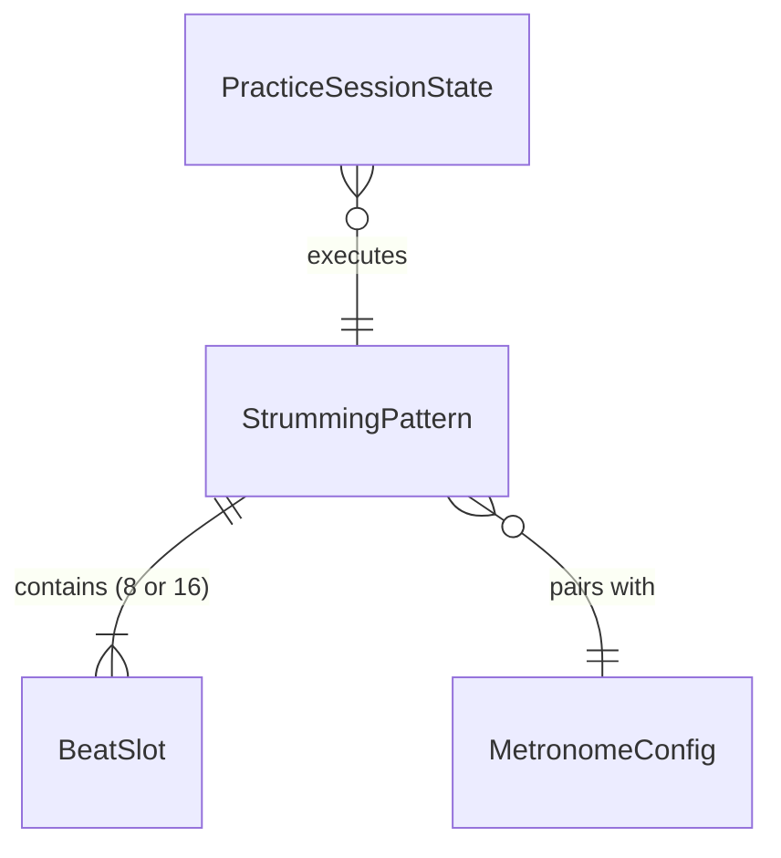
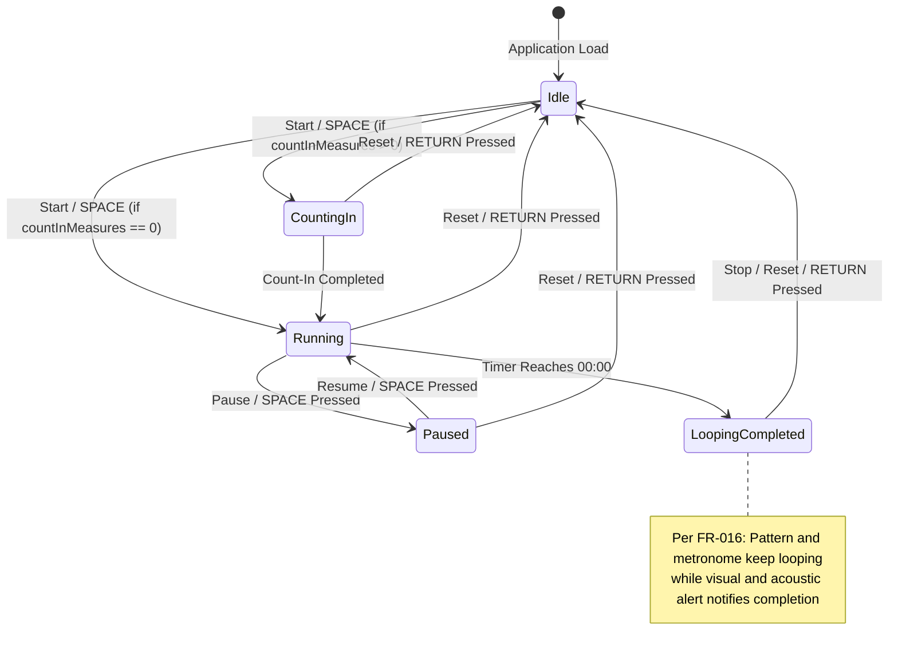

# Data Model: Strumming Pattern Trainer

**Feature**: `001-strumming-pattern-trainer`  
**Date**: 2026-11-01  
**Status**: Completed  

---

## 1. Domain Entities & Type Definitions

### 1.1 `StrokeDirection` (Enum)
Represents the action taken on a specific rhythmic division slot.
```typescript
export type StrokeDirection = 'down' | 'up' | 'none';
```
- `'down'`: Downward strum indicated by arrow `↓`.
- `'up'`: Upward strum indicated by arrow `↑`.
- `'none'`: Empty slot / rest / silent subdivision (no stroke).

---

### 1.2 `SubdivisionUnit` (Enum)
Defines the rhythmic division of the measure.
```typescript
export type SubdivisionUnit = 'eighth' | 'sixteenth';
```
- `'eighth'`: 8 slots per 4/4 measure (counts: `1`, `&`, `2`, `&`, `3`, `&`, `4`, `&`).
- `'sixteenth'`: 16 slots per 4/4 measure (counts: `1`, `e`, `&`, `a`, `2`, `e`, `&`, `a`, etc.).

---

### 1.3 `BeatSlot`
An individual slot along the rhythmic timeline.
```typescript
export interface BeatSlot {
  /** Zero-based index within the measure (0 to 7 for 8th, 0 to 15 for 16th) */
  index: number;
  /** Display label corresponding to the musical count */
  beatLabel: string;
  /** Strum direction executed at this division */
  strokeDirection: StrokeDirection;
  /** True if this slot falls on a primary downbeat (e.g. beat 1, 2, 3, 4) */
  isQuarterBeat: boolean;
  /** True if this slot represents the very first beat of the measure */
  isMeasureStart: boolean;
}
```

**Validation Rules**:
- `index` MUST be an integer between `0` and `slotsCount - 1`.
- `strokeDirection` MUST be one of `'down'`, `'up'`, or `'none'`.

---

### 1.4 `StrummingPattern`
Represents the rhythmic pattern configuration for practice and storage.
```typescript
export interface StrummingPattern {
  /** Unique identifier (e.g., 'preset-island-strum' or uuid for custom) */
  id: string;
  /** Human-readable title */
  name: string;
  /** Time signature represented as [beatsPerMeasure, beatValue]. Default [4, 4] */
  timeSignature: [number, number];
  /** Subdivisions per measure */
  subdivision: SubdivisionUnit;
  /** Sequence of rhythmic slots matching the subdivision length */
  slots: BeatSlot[];
  /** True if built into the beginner preset library; false if user-created */
  isPreset: boolean;
  /** Future authentication link; always null for anonymous guest mode */
  ownerId: string | null;
  /** Timestamp when pattern was created */
  createdAt: string; // ISO 8601
  /** Timestamp when pattern was last modified */
  updatedAt: string; // ISO 8601
}
```

**Validation Rules**:
- When `subdivision === 'eighth'`, `slots.length` MUST equal 8.
- When `subdivision === 'sixteenth'`, `slots.length` MUST equal 16.
- `name` MUST not be empty (minimum 1 character, maximum 50 characters).

---

### 1.5 `MetronomeSubdivision` (Enum)
Defines audio click pulse subdivisions per quarter beat:
```typescript
export type MetronomeSubdivision = 'quarter' | 'eighth' | 'sixteenth' | 'triplet' | 'swing';
```
- `'quarter'`: 1 click per beat (on the quarter downbeat ♩).
- `'eighth'`: 2 clicks per beat (downbeat + "&" upbeat ♫).
- `'sixteenth'`: 4 clicks per beat (16th note divisions).
- `'triplet'`: 3 clicks per beat (triplet 8th notes ³♫).
- `'swing'`: 2 clicks per beat with triplet swing feel (beat + 3rd triplet upbeat).

---

### 1.6 `MetronomeConfig`
Runtime metronome configuration.
```typescript
export interface MetronomeConfig {
  /** Tempo in beats per minute */
  bpm: number; // Range: 40 to 240
  /** Whether the first beat of each measure is pitch-accented */
  accentFirstBeat: boolean;
  /** Number of introductory count-in measures before loop begins */
  countInMeasures: 0 | 1 | 2 | 3;
  /** Sound profile identifier */
  soundTheme: 'woodblock' | 'click' | 'beep';
  /** Audio subdivision frequency */
  subdivision: MetronomeSubdivision;
  /** Enforces positional alternating stroke direction by default (odd slots = Down, even slots = Up) */
  strictAlternation: boolean;
}
```

**Validation Rules**:
- `bpm` MUST be clamped between 40 and 240 (inclusive).
- `bpm` MUST be an integer.
- `countInMeasures` MUST be one of 0, 1, 2, or 3.

---

### 1.6 `PracticeSessionState`
Tracks active practice timer state and flow.
```typescript
export type PracticeTimerStatus = 'idle' | 'counting-in' | 'running' | 'paused' | 'completed';

export interface PracticeSessionState {
  /** Target duration configured in seconds (e.g., 300 for 5 min) */
  targetDurationSeconds: number;
  /** Remaining countdown in seconds */
  remainingSeconds: number;
  /** Total elapsed active practice seconds during this session */
  elapsedSeconds: number;
  /** Lifecycle status of the timer */
  status: PracticeTimerStatus;
  /** Active count-in beat remaining (e.g., 4 down to 1) when in 'counting-in' status */
  countInBeatRemaining: number | null;
}
```
```

---

## 2. Entity Relationships



---

## 3. State Lifecycle & Transitions


