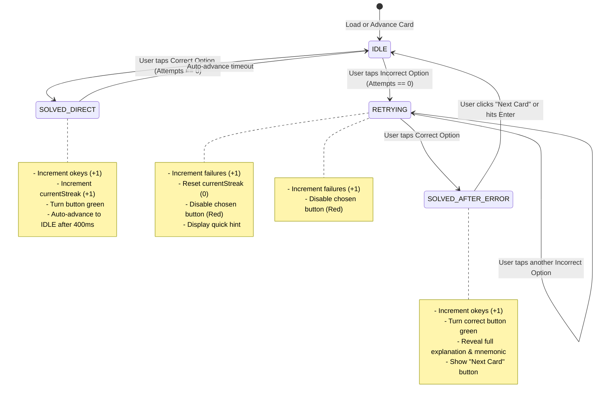

# Data Model: Basic Note Trainer

**Feature Branch**: `002-basic-note-trainer`  
**Date**: 2026-11-01  
**Status**: Completed  

---

## 1. Domain Entities & Type Definitions

```typescript
// --- Note Domain Primitives ---

export type NaturalLetter = 'A' | 'B' | 'C' | 'D' | 'E' | 'F' | 'G';

export type SolfegeNote = 'Do' | 'Re' | 'Mi' | 'Fa' | 'Sol' | 'La' | 'Si';

export type AccidentalSymbol = '#' | 'b' | 'none';

export interface ChromaticNoteInfo {
  letter: NaturalLetter;
  solfege: SolfegeNote;
  chromaticIndex: number; // 0 to 11 (C = 0, C# = 1, D = 2 ... B = 11)
  hasNaturalSharp: boolean; // false for B and E; true for C, D, F, G, A
  hasNaturalFlat: boolean;  // false for C and F; true for D, E, G, A, B
  enharmonicName?: string;  // e.g. "C# / Db"
}

// --- Question & Flashcard Entities ---

export type QuestionCategory = 'translation' | 'accidentals' | 'sequence';

export type DifficultyLevel = 'beginner' | 'intermediate' | 'advanced';

export type TrainerMode = 'translation' | 'accidentals' | 'mixed';

export type TranslationDirection = 'letters-to-solfege' | 'solfege-to-letters' | 'both';

export interface FlashcardQuestion {
  id: string;
  category: QuestionCategory;
  prompt: string;               // e.g. "What European note corresponds to 'D'?"
  subPrompt?: string;            // Secondary context or visual cue
  options: [string, string, string, string]; // Exactly 4 unique choices
  correctAnswer: string;
  hint: string;                 // Short hint shown on first failure
  explanation: string;          // Full theoretical explanation shown after recovery
  mnemonic: string;             // Memorable mnemonic / practical rule of thumb
  difficulty: DifficultyLevel;
  noteReference: string;        // The primary note key (e.g., "D", "E-F", "C#")
}

// --- Active Card Interaction State ---

export type CardStatus = 
  | 'IDLE'               // Fresh card, all options clickable
  | 'RETRYING'           // User missed >=1 choice, wrong buttons disabled in red
  | 'SOLVED_DIRECT'      // Solved on 1st attempt (auto-advancing after 400ms)
  | 'SOLVED_AFTER_ERROR'; // Solved after failure, full explanation + "Next" visible

export interface ActiveCardState {
  currentCard: FlashcardQuestion;
  status: CardStatus;
  attemptsOnCurrentCard: number;
  disabledOptions: string[];    // Options that were picked and were incorrect
  showExplanation: boolean;
  isFirstAttemptSuccess: boolean;
}

// --- Live Session & Cumulative Stats ---

export interface SessionStats {
  okeys: number;                // Total cards successfully resolved
  failures: number;             // Total incorrect clicks
  currentStreak: number;        // Consecutive first-attempt successes
  bestStreak: number;           // Peak streak in active session
  accuracy: number;             // percentage: (okeys / (okeys + failures)) * 100
  totalCardsSeen: number;
}

export interface StoredUserStats {
  version: 1;
  ownerId: null;                // Guest mode schema ready for future cloud sync
  lifetimeOkeys: number;
  lifetimeFailures: number;
  allTimeBestStreak: number;
  lastPlayedAt: string;         // ISO 8601 string
}

// --- Configuration & Embedding ---

export interface TrainerConfig {
  mode: TrainerMode;
  direction: TranslationDirection;
  difficulty: DifficultyLevel;
  embed: boolean;
}
```

---

## 2. State Transitions & Lifecycle Diagram



---

## 3. Validation Rules

1. **Option Cardinality**: Each `FlashcardQuestion` MUST have exactly 4 choices. No option text may be empty or duplicate another option in the same card.
2. **Deterministic Correct Answer**: `correctAnswer` MUST be strictly equal to one of the 4 items in `options`.
3. **Accuracy Bounds**: If `(okeys + failures) === 0`, `accuracy` displays as `100%` (or `--`). Otherwise, it is calculated as `Math.round((okeys / (okeys + failures)) * 100)`.
4. **Streak Calculation**:
   - `currentStreak` increments ONLY when a card is answered correctly on the very first attempt (`attemptsOnCurrentCard === 0`).
   - Any incorrect answer resets `currentStreak` immediately to `0`.
   - `bestStreak` is updated whenever `currentStreak > bestStreak`.
5. **No Double Scoring**: Once a card enters `SOLVED_DIRECT` or `SOLVED_AFTER_ERROR`, all option buttons become disabled to prevent duplicate state triggers.
