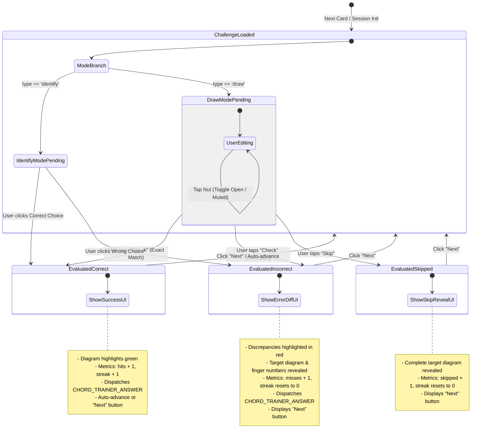

# Data Model: Basic Chord Trainer

**Feature Branch**: `003-basic-chord-trainer`  
**Date**: 2026-11-01  
**Status**: Completed  

---

## 1. Domain Entities & Type Definitions

```typescript
// --- Chord Primitives & Structure ---

export type StringNumber = 1 | 2 | 3 | 4 | 5 | 6; // 6 = Low E, 1 = High E

export type StringState = 'open' | 'muted' | 'fretted';

export type FingerNumber = 1 | 2 | 3 | 4; // 1=Index, 2=Middle, 3=Ring, 4=Pinky

export interface ChordStringDefinition {
  stringNumber: StringNumber;
  state: StringState;
  fret: number | null;     // 0 for open, 1-4 for fretted, null for muted
  finger?: FingerNumber | null;
}

export type ChordCategory = 
  | 'open-major' 
  | 'open-minor' 
  | 'open-7th' 
  | 'open-variation';

export interface ChordDefinition {
  id: string;               // e.g. "c-major", "a-minor", "f-beginner", "cadd9"
  symbol: string;           // Anglo-Saxon notation: e.g. "C", "Am", "G7", "Fmaj7"
  solfegeName: string;      // European Solfège: e.g. "Do Mayor", "La menor", "Sol 7ª"
  category: ChordCategory;
  // Strings ordered from 6 (Low E) down to 1 (High E)
  strings: [
    ChordStringDefinition,
    ChordStringDefinition,
    ChordStringDefinition,
    ChordStringDefinition,
    ChordStringDefinition,
    ChordStringDefinition
  ];
  rootString: StringNumber; // 6, 5, or 4
  barre?: {
    fret: number;
    fromString: StringNumber;
    toString: StringNumber;
  } | null;
  description?: {
    en: string;
    es: string;
  };
}

// --- Practice Modes & Challenge Entities ---

export type PracticeMode = 'alternate' | 'draw' | 'identify';

export type ChallengeType = 'draw' | 'identify';

export interface PracticeChallenge {
  id: string;
  targetChord: ChordDefinition;
  type: ChallengeType;
  // Multiple-choice options for 'identify' mode (exactly 4 unique chords)
  options?: [ChordDefinition, ChordDefinition, ChordDefinition, ChordDefinition];
}

// --- Interactive Fretboard User Input State ---

export interface UserStringFretting {
  stringNumber: StringNumber;
  state: StringState;
  fret: number | null;     // null if muted, 0 if open, 1-4 if fretted
}

export type UserFretboardState = [
  UserStringFretting, // String 6 (Low E)
  UserStringFretting, // String 5 (A)
  UserStringFretting, // String 4 (D)
  UserStringFretting, // String 3 (G)
  UserStringFretting, // String 2 (B)
  UserStringFretting  // String 1 (High E)
];

// --- Evaluation & Verification Results ---

export type ChallengeStatus =
  | 'PENDING'             // Awaiting user action (drawing frets or clicking choice)
  | 'EVALUATED_CORRECT'   // Hit / Acierto
  | 'EVALUATED_INCORRECT' // Miss / Fallo
  | 'SKIPPED';            // User tapped Skip / Saltar

export interface StringVerificationResult {
  stringNumber: StringNumber;
  isCorrect: boolean;
  expectedState: StringState;
  expectedFret: number | null;
  actualState: StringState;
  actualFret: number | null;
}

export interface ChallengeEvaluation {
  isCorrect: boolean;
  stringResults?: StringVerificationResult[];
  explanation: {
    en: string;
    es: string;
  };
}

// --- Session Metrics & Anonymous Persistence ---

export interface SessionMetrics {
  hits: number;           // Total correct submissions
  misses: number;         // Total incorrect submissions
  skipped: number;        // Total skipped cards
  currentStreak: number;  // Consecutive correct answers
  bestStreak: number;     // Session high streak
  accuracy: number;       // (hits / (hits + misses)) * 100
  totalCompleted: number;
}

export interface StoredChordTrainerData {
  version: 1;
  ownerId: null;          // Guest mode / Zero-Mock UI
  lastSelectedChordIds: string[];
  lastSelectedMode: PracticeMode;
  lifetimeHits: number;
  lifetimeMisses: number;
  allTimeBestStreak: number;
  lastPlayedAt: string;   // ISO 8601
}

// --- Trainer Configuration ---

export interface TrainerConfig {
  chords?: string[];      // Array of chord symbols/IDs or undefined (all catalog)
  mode: PracticeMode;     // 'alternate' (default), 'draw', or 'identify'
  embed: boolean;         // Suppresses chrome and enforces compact mode
  compact?: boolean;
  lang?: 'en' | 'es';
}
```

---

## 2. State Machine & User Flow Diagram



---

## 3. Validation Rules

1. **Dual Notation Integrity**: Every chord display in the UI MUST render both the Anglo-Saxon letter notation and European Solfège notation (e.g. `C (Do Mayor)`). Neither notation may be omitted.
2. **String Exclusivity**: A string can only be in one state at a time (`open`, `muted`, or `fretted` at exactly one fret between 1 and 4). Placing a fret dot clears any muted state on that string. Setting a string to muted clears any fretted dot on that string.
3. **Evaluation Determinism**: In "Draw" mode, an answer is correct if and only if all 6 strings match the target chord definition's state (`open`, `muted`, or `fretted` at the identical fret). Finger assignment is evaluated as guidance.
4. **Identify Options Cardinality**: In "Identify" mode, options MUST contain exactly 4 unique `ChordDefinition` entries including the target chord, randomized in order.
5. **Accuracy Metric**:
   - If `(hits + misses) === 0`, `accuracy` displays as `100%` (or `--`).
   - Otherwise: `Math.round((hits / (hits + misses)) * 100)`. Skipped cards do not increment hits or misses, but reset the current streak.
