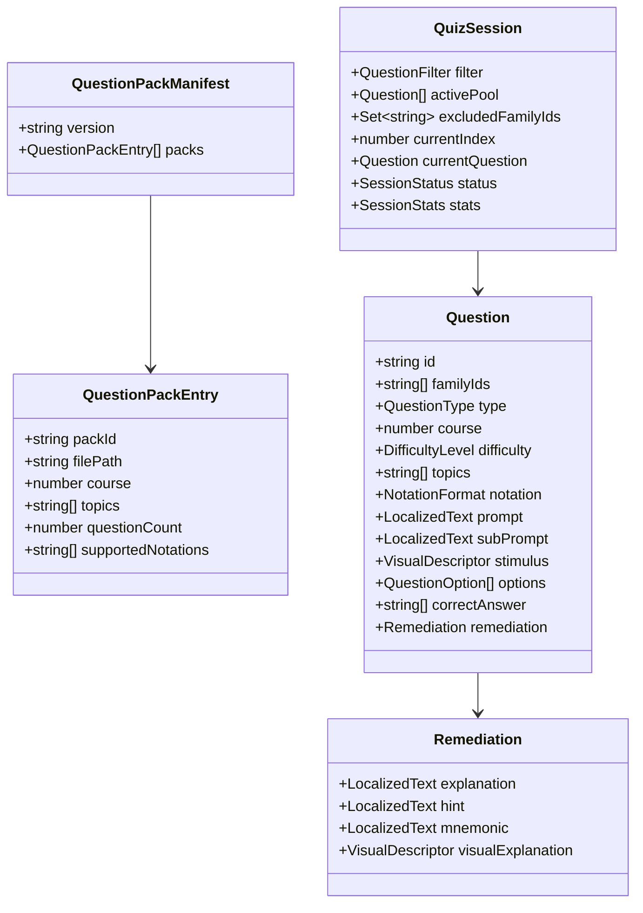
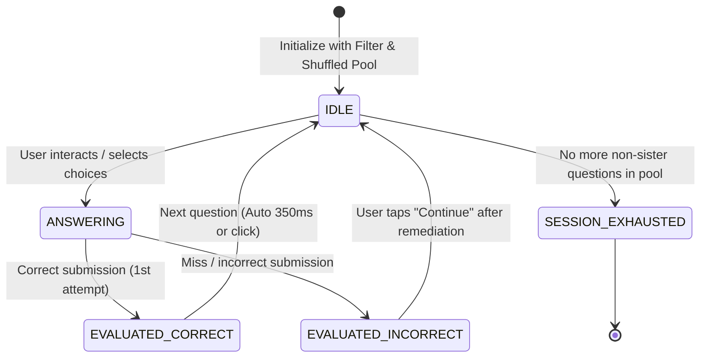

# Data Model: Interactive Learning & Quiz Framework

**Branch**: `004-interactive-quiz-framework` | **Date**: 2026-11-04 | **Feature**: [spec.md](./spec.md)

This document specifies the core entities, TypeScript interfaces, Zod schemas, and state machine lifecycle for the interactive quiz framework.

---

## 1. Core Domain Entities & Zod Schemas



### 1.1 Localized Content Primitive

```typescript
export interface LocalizedText {
  en: string;
  es: string;
}
```

### 1.2 Question Options & Stimulus

```typescript
export type QuestionType = 'single-choice' | 'multiple-choice' | 'interactive-visual';
export type DifficultyLevel = 'beginner' | 'intermediate' | 'advanced';
export type NotationFormat = 'letters' | 'solfege' | 'dual' | 'neutral';

export interface VisualDescriptor {
  visualType: string;
  visualProps: Record<string, unknown>;
}

export interface QuestionOption {
  id: string;
  label: LocalizedText;
  visualCue?: VisualDescriptor;
}

export interface Remediation {
  explanation: LocalizedText;
  hint?: LocalizedText;
  mnemonic?: LocalizedText;
  visualExplanation?: VisualDescriptor;
}

export interface Question {
  id: string;
  familyIds?: string[];
  type: QuestionType;
  course: number;
  difficulty: DifficultyLevel;
  topics: string[];
  notation: NotationFormat;
  prompt: LocalizedText;
  subPrompt?: LocalizedText;
  stimulus?: VisualDescriptor;
  options: QuestionOption[];
  correctAnswer: string[]; // 1 element for single-choice; >= 1 for multiple-choice
  remediation: Remediation;
}
```

### 1.3 Pack Manifest & Catalog

```typescript
export interface QuestionPackEntry {
  packId: string;
  filePath: string;
  course: number;
  topics: string[];
  questionCount: number;
  supportedNotations: NotationFormat[];
}

export interface QuestionPackManifest {
  version: '1.0';
  packs: QuestionPackEntry[];
}
```

---

## 2. Dynamic Filtering & Query Model

```typescript
export interface QuestionFilter {
  courses?: number[]; // e.g. [1, 2, 3, 4, 5]
  difficulties?: DifficultyLevel[]; // e.g. ['beginner', 'intermediate']
  topics?: string[]; // e.g. ['notes', 'chords']
  notation?: NotationFormat | 'any'; // 'letters' | 'solfege' | 'any'
}
```

### Filter Predicate Rule
A question `Q` matches `QuestionFilter F` if and only if:
1. `F.courses` is undefined OR `F.courses.includes(Q.course)`.
2. `F.difficulties` is undefined OR `F.difficulties.includes(Q.difficulty)`.
3. `F.topics` is undefined OR `F.topics.some(t => Q.topics.includes(t))`.
4. `F.notation` is undefined OR `F.notation === 'any'` OR `Q.notation === 'neutral'` OR `Q.notation === 'dual'` OR `Q.notation === F.notation`.

---

## 3. Carousel & Multi-Family Exclusion State Machine



### 3.1 State Shape

```typescript
export type SessionStatus =
  | 'IDLE'                 // Ready for interaction
  | 'ANSWERING'            // Options picked or in-progress
  | 'EVALUATED_CORRECT'    // Solved cleanly
  | 'EVALUATED_INCORRECT'  // Error triggered, remediation card visible
  | 'SESSION_EXHAUSTED';   // Pool exhausted (all non-sister items answered)

export interface SessionStats {
  hits: number;
  misses: number;
  currentStreak: number;
  bestStreak: number;
  accuracy: number;        // (hits / (hits + misses)) * 100
  totalCompleted: number;
}

export interface QuizSessionState {
  filter: QuestionFilter;
  candidatePool: Question[];
  activeQuestion: Question | null;
  excludedFamilyIds: Set<string>;
  servedQuestionIds: Set<string>;
  selectedOptionIds: string[];
  status: SessionStatus;
  stats: SessionStats;
}
```

### 3.2 Carousel Invariant & Transition Rules

1. **Initial Population**:
   - Filter all loaded questions by `filter`.
   - Perform pure Fisher-Yates shuffle on candidates: `candidatePool = shuffle(matchedQuestions)`.
   - `excludedFamilyIds = new Set<string>()`.
   - `servedQuestionIds = new Set<string>()`.
   - Draw first eligible question: `activeQuestion = drawNextEligible(candidatePool, excludedFamilyIds)`.

2. **`drawNextEligible(pool, excludedFamilies)`**:
   - Find first question in `pool` where:
     `!question.familyIds || !question.familyIds.some(f => excludedFamilies.has(f))`
   - Remove it from `candidatePool`.
   - If question found:
     - If `question.familyIds`: add all to `excludedFamilies`.
     - `servedQuestionIds.add(question.id)`.
     - Return question.
   - If no question found: Return `null` (triggers `SESSION_EXHAUSTED`).

3. **Multi-Select Scoring Evaluation (`evaluateAnswer(question, selectedIds)`)**:
   - `expectedSet = new Set(question.correctAnswer)`.
   - `actualSet = new Set(selectedIds)`.
   - `falsePositives = selectedIds.filter(id => !expectedSet.has(id))`.
   - `falseNegatives = question.correctAnswer.filter(id => !actualSet.has(id))`.
   - `isCorrect = falsePositives.length === 0 && falseNegatives.length === 0`.
   - Return `{ isCorrect, falsePositives, falseNegatives }`.

---

## 4. Visual Component Registry Model

```typescript
import React from 'react';

export type VisualComponentProps = {
  props: Record<string, unknown>;
  isInteractive?: boolean;
  onInteract?: (data: unknown) => void;
  lang?: 'en' | 'es';
  compact?: boolean;
};

export type VisualComponentType = React.ComponentType<VisualComponentProps>;

export interface VisualRegistryInterface {
  register(visualType: string, component: VisualComponentType): void;
  get(visualType: string): VisualComponentType | undefined;
  has(visualType: string): boolean;
}
```
