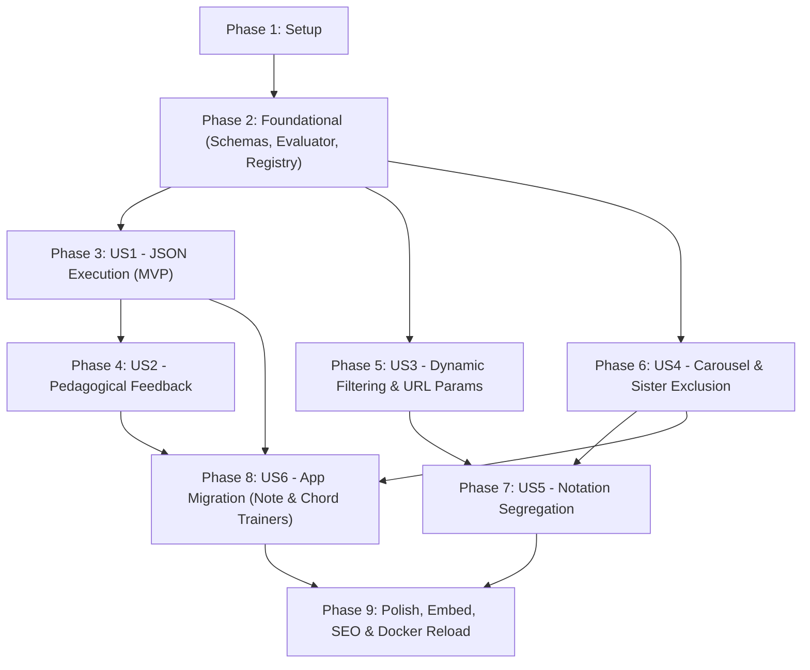

# Tasks: Interactive Learning & Quiz Framework

**Input**: Design documents from `/specs/004-interactive-quiz-framework/`
**Prerequisites**: [plan.md](./plan.md) (required), [spec.md](./spec.md) (required for user stories), [research.md](./research.md), [data-model.md](./data-model.md), [contracts/](./contracts/)
**Organization**: Tasks are grouped by user story to enable independent implementation and testing of each story.

## Format: `[ID] [P?] [Story] Description`

- **[P]**: Can run in parallel (different files, no dependencies on incomplete tasks)
- **[Story]**: Which user story this task belongs to (e.g., [US1], [US2], [US3]...); omitted for Setup, Foundational, and Polish phases
- Every task includes exact target file paths and explicit constraints quoted verbatim from design models

---

## Phase 1: Setup (Shared Infrastructure)

**Purpose**: Project initialization, directory structure, manifest stub, and public export boundaries.

- [X] T001 Create framework directory structure at `src/core/quiz/` (`types/`, `engine/`, `registry/`, `components/`, `hooks/`) and content directory at `src/content/quizzes/` (`courses/`, `topics/`)
- [X] T002 [P] Initialize question pack index manifest in `src/content/quizzes/manifest.json` conforming to `QuestionPackManifest` schema (`version: "1.0"`, `packs: []`)
- [X] T003 [P] Create public module re-exports and barrel stub in `src/core/quiz/index.ts`

---

## Phase 2: Foundational (Blocking Prerequisites)

**Purpose**: Core schemas, domain types, state machine contracts, visual registry, and evaluation engine that MUST be complete before ANY user story can be implemented.

**⚠️ CRITICAL**: No user story work can begin until this phase is complete.

- [X] T004 [P] Define Zod schemas and TypeScript interfaces in `src/core/quiz/types/schema.ts` strictly validating `QuestionType` (`'single-choice' | 'multiple-choice' | 'interactive-visual'`), `DifficultyLevel` (`'beginner' | 'intermediate' | 'advanced'`), `NotationFormat` (`'letters' | 'solfege' | 'dual' | 'neutral'`), `LocalizedText` (`{ en: string; es: string }`), `VisualDescriptor` (`{ visualType: string; visualProps: Record<string, unknown> }`), `QuestionOption` (`{ id: string; label: LocalizedText; visualCue?: VisualDescriptor }`), `Remediation` (`{ explanation: LocalizedText; hint?: LocalizedText; mnemonic?: LocalizedText; visualExplanation?: VisualDescriptor }`), and `Question` (`id: string`, `familyIds?: string[]`, `type: QuestionType`, `course: number`, `difficulty: DifficultyLevel`, `topics: string[]`, `notation: NotationFormat`, `prompt: LocalizedText`, `subPrompt?: LocalizedText`, `stimulus?: VisualDescriptor`, `options: QuestionOption[]`, `correctAnswer: string[]`, `remediation: Remediation`)
- [X] T005 [P] Define session state types, lifecycle statuses, and action interfaces in `src/core/quiz/types/session.ts` defining `SessionStatus` (`'IDLE' | 'ANSWERING' | 'EVALUATED_CORRECT' | 'EVALUATED_INCORRECT' | 'SESSION_EXHAUSTED'`), `SessionStats` (`hits: number`, `misses: number`, `currentStreak: number`, `bestStreak: number`, `accuracy: number`, `totalCompleted: number`), and `QuizSessionState` (`filter`, `candidatePool`, `activeQuestion`, `excludedFamilyIds: Set<string>`, `servedQuestionIds: Set<string>`, `selectedOptionIds: string[]`, `status`, `stats`)
- [X] T006 [P] Implement Decoupled Visual Component Registry in `src/core/quiz/registry/visualRegistry.ts` conforming to `VisualRegistryInterface` (`register(visualType: string, component: VisualComponentType): void`, `get(visualType: string): VisualComponentType | undefined`, `has(visualType: string): boolean`)
- [X] T007 [P] Implement pure answer evaluator in `src/core/quiz/engine/evaluator.ts` implementing `evaluateAnswer(question: Question, selectedIds: string[])` with all-or-nothing logic returning `{ isCorrect: boolean, falsePositives: string[], falseNegatives: string[] }`
- [X] T008 Implement pack loader and schema validator in `src/core/quiz/engine/packLoader.ts` reading `src/content/quizzes/manifest.json` and verifying loaded packs against `QuestionSchema`
- [X] T009 [P] Create unit test suite in `tests/unit/core/quiz/validatePacks.test.ts` validating all JSON question packs against Zod schemas and asserting ID uniqueness
- [X] T010 [P] Create unit test suite in `tests/unit/core/quiz/evaluator.test.ts` verifying single-choice and all-or-nothing multiple-choice grading, false positive detection, and false negative diagnostics

**Checkpoint**: Foundation ready - all core types, validators, evaluation logic, and registry ready for user story implementations.

---

## Phase 3: User Story 1 - JSON-Driven Dynamic Question Execution (Priority: P1) 🎯 MVP

**Goal**: Load questions and options dynamically from structured external JSON files with single-choice, multiple-choice, and visual descriptor support, rendering them through a generic runner without hardcoded application logic.

**Independent Test**: Load a test JSON question pack containing single-choice, multiple-choice, and visual stimulus questions, start a quiz session, and verify prompt rendering, option selections, and evaluation responses work correctly.

### Tests for User Story 1 ⚠️

- [X] T011 [P] [US1] Create unit test suite in `tests/unit/core/quiz/QuestionView.test.tsx` verifying single-choice selection, multi-select toggling, submit action, and visual stimulus delegation

### Implementation for User Story 1

- [X] T012 [P] [US1] Create initial modular question pack in `src/content/quizzes/courses/course-01-notes.json` containing note translation questions (`single-choice` and `multiple-choice`) with bilingual `en`/`es` prompts and valid remediation objects
- [X] T013 [P] [US1] Implement responsive option grid in `src/core/quiz/components/OptionGrid.tsx` rendering selectable option buttons with accessible touch targets $\ge 44\times 44$px supporting single and multi-select states
- [X] T014 [US1] Implement QuestionView component in `src/core/quiz/components/QuestionView.tsx` rendering localized `prompt`, `subPrompt`, optional stimulus via `visualRegistry`, options grid, and explicit submit button for multiple-choice questions
- [X] T015 [US1] Implement core QuizRunner container in `src/core/quiz/components/QuizRunner.tsx` coordinating question display, option selection state, and submission handling in guest mode

**Checkpoint**: User Story 1 is functional as an independent MVP. Learners can answer single-choice and multi-choice questions loaded dynamically from external JSON.

---

## Phase 4: User Story 2 - Pedagogical Feedback Beyond Plain Text (Priority: P1)

**Goal**: Provide rich educational explanation upon an incorrect attempt, detailing why the chosen answer was wrong (diagnostic breakdown), explaining the theoretical principle, offering mnemonic memory aids, and displaying corrective visual diagrams.

**Independent Test**: Trigger an incorrect answer and assert that the remediation panel appears immediately in-place, displaying the theoretical explanation, diagnostic false positive/negative highlights, mnemonic aid, and visual explanation component.

### Tests for User Story 2 ⚠️

- [X] T016 [P] [US2] Create unit test suite in `tests/unit/core/quiz/RemediationCard.test.tsx` verifying rendering of theoretical explanation (`remediation.explanation`), error diff diagnostics (`falsePositives`, `falseNegatives`), mnemonics (`remediation.mnemonic`), and visual explanation (`remediation.visualExplanation`)

### Implementation for User Story 2

- [X] T017 [US2] Implement RemediationCard component in `src/core/quiz/components/RemediationCard.tsx` rendering localized `remediation.explanation`, explicit error diagnostics for selected false positives and omitted false negatives, `remediation.mnemonic` callout, and `remediation.visualExplanation` via `visualRegistry`
- [X] T018 [US2] Integrate immediate in-place remediation flow into `src/core/quiz/components/QuizRunner.tsx`, displaying RemediationCard on `EVALUATED_INCORRECT` with a prominent "Continue" action to resume play

**Checkpoint**: User Stories 1 AND 2 operate harmoniously. Mistakes immediately trigger rich, multi-modal pedagogical remediation.

---

## Phase 5: User Story 3 - Multi-Dimensional Dynamic Filtering & Course Ranges (Priority: P2)

**Goal**: Enable dynamic practice session configuration by filtering question pools across course numbers/ranges (e.g., `courses: [1, 2, 3, 4, 5]`), difficulty levels (`beginner`, `intermediate`, `advanced`), topic intersections, and notation systems, with declarative URL parameter synchronization.

**Independent Test**: Pass custom query criteria (e.g. `courses=1-3&difficulty=beginner`), verify that candidate pool contains exclusively questions matching all criteria, and verify empty-state notice appears when zero questions match.

### Tests for User Story 3 ⚠️

- [X] T019 [P] [US3] Create unit test suite in `tests/unit/core/quiz/filter.test.ts` verifying filter predicate rules for course ranges, difficulty levels, topic intersections, and notation matching
- [X] T020 [P] [US3] Create unit test suite in `tests/unit/core/quiz/urlParams.test.ts` verifying URL query parameter parsing, range transformations (e.g., `"1-5"` → `[1,2,3,4,5]`), sanitization, and fallback defaults

### Implementation for User Story 3

- [X] T021 [P] [US3] Implement dynamic multi-dimensional question filter in `src/core/quiz/engine/filter.ts` evaluating `QuestionFilter` (`courses?: number[]`, `difficulties?: DifficultyLevel[]`, `topics?: string[]`, `notation?: NotationFormat | 'any'`) against candidate questions
- [X] T022 [US3] Implement declarative URL parameter parsing and state synchronization hook in `src/core/quiz/hooks/useQuizUrlParams.ts` conforming to `QuizUrlParamsSchema` in `contracts/url-params.contract.ts`
- [X] T023 [US3] Implement EmptyPoolNotice component in `src/core/quiz/components/EmptyPoolNotice.tsx` and integrate into `src/core/quiz/components/QuizRunner.tsx` to display helpful recovery recommendations when 0 questions match the filter

**Checkpoint**: User Stories 1, 2, and 3 are functional. Sessions can be dynamically filtered via code or declarative URL query parameters.

---

## Phase 6: User Story 4 - Carousel Non-Repetition & Sister Question Exclusion (Priority: P2)

**Goal**: Guarantee zero question repetition in a study session and enforce multi-family sister question mutual exclusion across all associated `familyIds` (`familyIds: string[]`), providing a continuous gamified stream with live streak and accuracy tracking.

**Independent Test**: Seed a candidate pool with sister questions sharing `familyIds`, answer one, and assert that all remaining candidate questions sharing any of its `familyIds` are immediately excluded from the remainder of the session.

### Tests for User Story 4 ⚠️

- [X] T024 [P] [US4] Create unit test suite in `tests/unit/core/quiz/carousel.test.ts` verifying pure Fisher-Yates shuffling, non-repeating draws, and multi-family mutual exclusion invariant
- [X] T025 [P] [US4] Create unit test suite in `tests/unit/core/quiz/useQuizSession.test.ts` verifying session state machine transitions (`IDLE` → `ANSWERING` → `EVALUATED_CORRECT` / `EVALUATED_INCORRECT` → `SESSION_EXHAUSTED`), live streak calculations, accuracy %, and pool exhaustion

### Implementation for User Story 4

- [X] T026 [P] [US4] Implement carousel draw and multi-family exclusion algorithm in `src/core/quiz/engine/carousel.ts` implementing `drawNextEligible(pool: Question[], excludedFamilies: Set<string>): Question | null`
- [X] T027 [US4] Implement session state reducer and hook in `src/core/quiz/hooks/useQuizSession.ts` managing `QuizSessionState`, Fisher-Yates initialization, non-repeating draws, streak updates, and guest persistence via `@/core/storage/typedStorage.ts` with `ownerId: null`
- [X] T028 [US4] Implement SessionProgressBar component in `src/core/quiz/components/SessionProgressBar.tsx` displaying live current streak, best streak, and accuracy percentage, integrated into `src/core/quiz/components/QuizRunner.tsx`

**Checkpoint**: Core carousel engine complete. Questions never repeat, sister variants are excluded across multiple families, and streak mechanics operate continuously.

---

## Phase 7: User Story 5 - Notation Segregation & Balanced Mixing (Priority: P3)

**Goal**: Allow explicit selection between Anglo-Saxon letter notation, traditional European Solfège notation, or a balanced mix, with sister questions preventing duplicate variants from appearing in the same session.

**Independent Test**: Request `notation=letters` and verify 100% of served questions use Anglo-Saxon letters; request `notation=solfege` and verify Latin Solfège notation; request `notation=any` and verify both appear without sister duplicate conflicts.

### Tests for User Story 5 ⚠️

- [X] T029 [P] [US5] Create unit test suite in `tests/unit/core/quiz/notationFilter.test.ts` verifying strict notation segregation (`letters` vs `solfege`) and dual/neutral question fallbacks

### Implementation for User Story 5

- [X] T030 [P] [US5] Author modular question pack for semitones and accidentals in `src/content/quizzes/courses/course-02-accidentals.json` defining paired letter and solfège questions linked by shared `familyIds` (e.g. `family-csharp-translation`)
- [X] T031 [US5] Update index manifest in `src/content/quizzes/manifest.json` registering `course-02-accidentals.json` with course number `2` and supported notations `["letters", "solfege", "dual"]`
- [X] T032 [US5] Enhance notation filter handling in `src/core/quiz/engine/filter.ts` and add accessible notation selector toggle to `src/core/quiz/components/QuizRunner.tsx`

**Checkpoint**: Notation segregation and mixing fully operational with zero sister collisions across musical conventions.

---

## Phase 8: User Story 6 - Migration of Existing Trainer Apps to JSON-Driven Engine (Priority: P2)

**Goal**: Migrate `basic-note-trainer` and `basic-chord-trainer` to consume the new JSON-driven framework and external question packs without altering public routes, user interfaces, or breaking test coverage.

**Independent Test**: Run existing automated test suites (`tests/apps/basic-note-trainer/` and `tests/apps/basic-chord-trainer/`) and assert 100% test pass rate with zero regression.

### Implementation for User Story 6

- [X] T033 [P] [US6] Author open chords modular question pack in `src/content/quizzes/topics/open-chords.json` extracting 22 chords from `chordCatalog.ts` with "identify" and "draw" sister question family IDs
- [X] T034 [P] [US6] Register `ChromaticScaleVisualizer` and `FretboardDiagram` in `src/core/quiz/registry/visualRegistry.ts` (mapping `chromatic-scale` and `fretboard-diagram` visual types)
- [X] T035 [US6] Refactor `BasicNoteTrainerContainer` in `src/apps/basic-note-trainer/components/BasicNoteTrainerContainer.tsx` to delegate session management to `@/core/quiz` hooks and JSON packs while preserving existing UI styling, routes, and query parameters
- [X] T036 [US6] Refactor `BasicChordTrainerContainer` in `src/apps/basic-chord-trainer/components/BasicChordTrainerContainer.tsx` to consume `@/core/quiz` and `open-chords.json`, preserving existing Identify and Draw interaction modes and routes
- [X] T037 [P] [US6] Update implementation plan in `specs/002-basic-note-trainer/plan.md` adding migration addendum referencing spec `004`
- [X] T038 [P] [US6] Update implementation plan in `specs/003-basic-chord-trainer/plan.md` adding migration addendum referencing spec `004`

**Checkpoint**: Both existing trainer apps are migrated to the shared JSON engine. 100% backward compatibility maintained.

---

## Phase 9: Polish & Cross-Cutting Concerns

**Purpose**: Embed view support, PostMessage bridge, public showcase routes, SEO structured data, platform navigation integration, and Docker container verification.

- [X] T039 [P] Implement PostMessage bridge hook in `src/core/quiz/hooks/useQuizPostMessage.ts` emitting `QUIZ_ANSWER`, `QUIZ_PROGRESS`, and `QUIZ_EXHAUSTED` events conforming to `contracts/postmessage.contract.ts`
- [X] T040 [P] Implement public showcase page in `src/app/(apps)/quiz/page.tsx` with SSR pre-rendered layout, semantic HTML hierarchy, dynamic OpenGraph metadata, and JSON-LD structured data
- [X] T041 [P] Implement embed route in `src/app/(apps)/quiz/embed/page.tsx` activating `embed=true` and `compact=true` with suppressed platform header and bottom navigation
- [X] T042 [P] Update platform navigation in `src/core/ui/navigation.ts` adding `/quiz` entry with localized EN/ES labels and icon representation
- [X] T043 Run complete automated test suite (`bun test --preload ./tests/setup.ts`) verifying all core, unit, app, and pack validation tests pass
- [X] T044 Execute Docker production reload (`bun run docker:reload`) and verify health endpoint `curl -f http://192.168.1.202:3100/api/health`

---

## Phase 10: Visual Component Extraction, Homogenization & Route Deferral

**Purpose**: Extract visual question components from note trainer and chord trainer into common primitives, harmonize styling to be mobile-first and compact, eliminate horizontal overflow in embedded webviews, and temporarily remove the standalone `/quiz` route.

- [X] T045 [P] Extract unified question visual primitives into `src/core/ui/questions/` (`QuestionCard`, `QuestionHeader`, `StimulusContainer`, `ActionNextButton`, `MnemonicBanner`, `FeedbackBanner`)
- [X] T046 [P] Restyle `src/core/quiz/components/` (`OptionGrid`, `QuestionView`, `RemediationCard`, `SessionProgressBar`, `EmptyPoolNotice`, `QuizRunner`) to match dark neutral theme with strict 2×2 grid, mobile-first compact layout, and zero horizontal scroll
- [X] T047 [P] Adopt shared question primitives across `IdentifyChallenge`, `Flashcard`, and `ExplanationCard`
- [X] T048 [P] Remove standalone `/quiz` route (`src/app/(apps)/quiz/`) and purge `/quiz` navigation from `PlatformHeader.tsx`, `PlatformBottomNav.tsx`, and `app/page.tsx`
- [X] T049 Update feature specifications (`spec.md`, `plan.md`, `tasks.md`) reflecting deferral of `/quiz` route and component homogenization
- [X] T050 Run complete test suite and execute mandatory Docker production reload (`bun run docker:reload`)

---

## Dependencies & Execution Order

### Phase Dependencies

- **Setup (Phase 1)**: No dependencies — can start immediately
- **Foundational (Phase 2)**: Depends on Phase 1 — BLOCKS all user stories
- **User Story 1 (Phase 3)**: Depends on Phase 2 — MVP foundation
- **User Story 2 (Phase 4)**: Depends on Phase 3 (extends QuizRunner and feedback flow)
- **User Story 3 (Phase 5)**: Depends on Phase 2 (filter logic can proceed in parallel with US1/US2)
- **User Story 4 (Phase 6)**: Depends on Phase 2 and integrates with US1/US2/US3
- **User Story 5 (Phase 7)**: Depends on Phase 5 and Phase 6 (notation filter & sister exclusion)
- **User Story 6 (Phase 8)**: Depends on Phases 1–6 (framework must be stable before migrating apps)
- **Polish (Phase 9)**: Depends on all user story phases

### User Story Completion Graph



---

## Parallel Execution Examples

### User Story 1 (JSON Execution)
```bash
# Launch test and pack authoring in parallel:
Task: "T011 [P] [US1] Create unit test suite in tests/unit/core/quiz/QuestionView.test.tsx"
Task: "T012 [P] [US1] Create initial modular question pack in src/content/quizzes/courses/course-01-notes.json"
Task: "T013 [P] [US1] Implement responsive option grid in src/core/quiz/components/OptionGrid.tsx"
```

### User Story 3 (Filtering & URL Params)
```bash
# Launch filter tests, URL param tests, and filter engine in parallel:
Task: "T019 [P] [US3] Create unit test suite in tests/unit/core/quiz/filter.test.ts"
Task: "T020 [P] [US3] Create unit test suite in tests/unit/core/quiz/urlParams.test.ts"
Task: "T021 [P] [US3] Implement dynamic multi-dimensional question filter in src/core/quiz/engine/filter.ts"
```

### User Story 4 (Carousel & Sister Exclusion)
```bash
# Launch carousel tests and pure shuffle algorithm in parallel:
Task: "T024 [P] [US4] Create unit test suite in tests/unit/core/quiz/carousel.test.ts"
Task: "T026 [P] [US4] Implement carousel draw and multi-family exclusion algorithm in src/core/quiz/engine/carousel.ts"
```

---

## Implementation Strategy

### MVP First (Phases 1, 2, and 3)
1. Complete Phase 1: Setup directory structure and manifest stub.
2. Complete Phase 2: Core Zod schemas, evaluator, and visual registry.
3. Complete Phase 3: User Story 1 — load and execute single-choice and multiple-choice questions from JSON.
4. **STOP and VALIDATE**: Verify that questions render and can be answered cleanly.

### Incremental Delivery
1. Add Phase 4 (US2): Integrate immediate pedagogical remediation on error.
2. Add Phase 5 (US3): Add dynamic filtering by course ranges, topics, and difficulties with URL params.
3. Add Phase 6 (US4): Enable continuous gamified carousel with multi-family sister exclusion and live streak tracking.
4. Add Phase 7 (US5): Enable notation segregation (Letters vs Solfège) with sister variants.
5. Add Phase 8 (US6): Migrate `basic-note-trainer` and `basic-chord-trainer` without regression.
6. Complete Phase 9: Polish embed routes, SEO metadata, PostMessage bridge, and Docker reload.

---

## Notes

- Every task strictly complies with `- [ ] [TaskID] [P?] [Story?] Description with file path`.
- Core engine (`@/core/quiz/`) remains 100% domain-agnostic (Constitution Principle VII).
- Content lives exclusively in modular JSON files under `src/content/quizzes/`.
- Guest persistence strictly sets `ownerId: null` in compliance with Zero-Mock UI (Constitution Principle IV).
- Mandatory Docker reload (`bun run docker:reload`) and health check included as definition of done.
